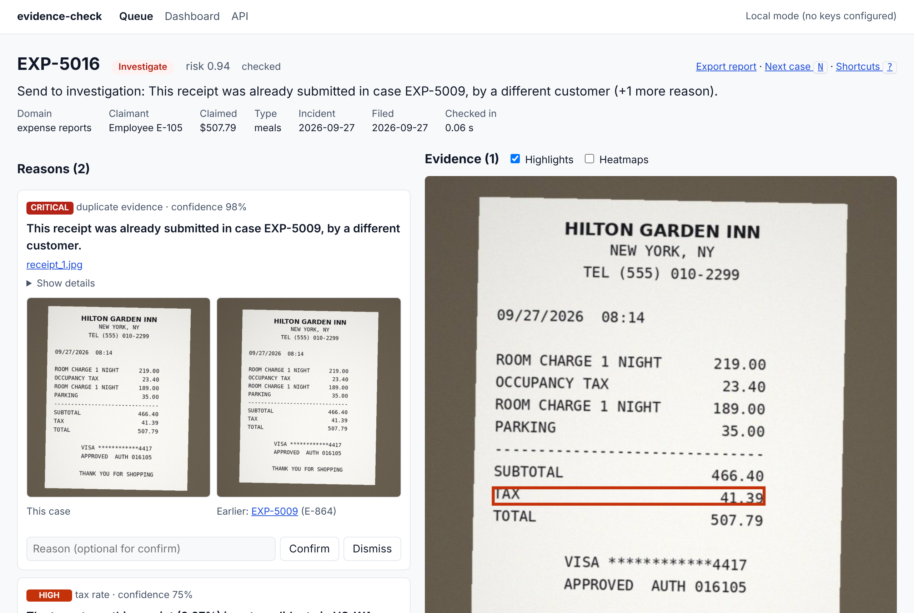

# evidence-check

**Checks the evidence behind insurance claims and expense reports: photos, receipts, PDFs and voice statements.**
Is each file what it claims to be, does the whole case agree with itself, and has this evidence been seen before?
Self-hosted, CPU-only, open models from Hugging Face, no API costs. Flags go to a person with the reason and the
spot in the file; nothing is ever denied automatically.



## Why

Generative AI made fake receipts and doctored damage photos cheap. Most tools answer one question about one file
("is this image AI-generated?"), and the detectors behind them are unreliable on real phone photos: the open detector
used here flags **22% of genuine car-damage photos** as generated. Fraud usually shows up somewhere else: a receipt
whose numbers don't add up, a payment that never happened, a photo taken before the policy started, the same photo
submitted by another customer, a voice statement that tells a different story from the form.

evidence-check checks **across** the evidence of a case and against everything it has seen before.

## Results

Measured on generated cases with planted manipulations (22 kinds, claims and expenses), read by the real models:
Florence-2 OCR on photographed receipts, CLIP on real car-damage photos, spoken statements transcribed by Whisper.

| Layers | Manipulations caught | False alarms on clean cases |
|---|---|---|
| Pixel forensics only (what a typical single-image detector sees) | 5% | 0% |
| + file metadata and provenance | 18% | 0% |
| + cross-evidence consistency (receipts, payments, dates, GPS, photo content, statement) | 95% | 0% |
| + history (reuse across cases and customers) | **100% (44/44)** | **0% (0/48)** |

With perfect perception (ground-truth OCR) on 460 cases: 220/220 caught, 0/240 false alarms. Under laundering
(recompression, cropping, stripped metadata, screenshots, re-photographs) everything grounded in text, payments and history
is still caught; metadata-only signals are not, which is why no layer decides alone.
[Real-model run](docs/results/benchmark_real.md) · [oracle run](docs/results/benchmark_oracle.md) ·
[robustness](docs/results/robustness.md) · [model cards](docs/MODEL_CARDS.md)

These are planted manipulations, so they show the system works as designed end to end; they are not a measurement of
real-world fraud recall. That number comes from a client's own past cases (`evcheck calibrate`) and a shadow pilot
([playbook](docs/playbook/README.md)).

### What the real models broke, and what changed

Running real models surfaced problems the oracle run could not. Each one is now covered by a test:

- **The detector was right, the labels were wrong.** Seven "false alarms" were the same genuine photo used in two
  clean cases by the generator (perceptual-hash distance 0/64).
- **OCR fell into a loop** on a dashed separator line and never read the totals, so the payment check silently did not
  run. Fix: a second OCR look (repetition penalty, then a bottom-half crop), and an `unreadable` check that sends a
  receipt with no readable total to a person instead of letting the case pass.
- **Copy-move missed dark photos** (fire, soot). Fix: contrast equalisation as a second look; 20/20 with no new false alarms.
- **Error-level analysis fired 13 times and was right 0 times**, and the AI-image detector flags 1 in 5 genuine photos.
  Both are now supporting signals that cannot raise a verdict on their own.
- **The self-improvement gate could be fooled by bad labels**: with those seven mislabelled cases, down-weighting
  the duplicate check passed every metric. The gate now forbids silencing critical findings and lists the exact cases
  whose verdict a change would flip, so the person approving looks at cases, not only rates.

## Quick start

```bash
pip install -e ".[models,mcp]"      # Python 3.11+, CPU is fine
evcheck demo                         # sample claims and expenses, then the reviewer UI on the riskiest case
```

`evcheck demo` uses ground-truth perception so it starts instantly and offline. For the real models:

```bash
evcheck models download               # pinned revisions, safetensors only, verified against models.lock.json
evcheck check path/to/case --models real --html report.html
```

A case is a folder with `case.json` and the files it lists ([format](docs/playbook/data_checklist.md)).

## What it checks

| Layer | Checks |
|---|---|
| Each file | camera/editing metadata, content credentials (C2PA), AI-generator traces, PDF structure and scripts, copy-move cloning, error-level analysis (supporting), AI-image detector (advisory), unreadable receipts |
| The whole case | receipt arithmetic, tax rate for the jurisdiction, receipts vs claimed amount, receipts vs card payments, photo and receipt dates vs incident and policy, photo GPS vs incident location, photo content vs claimed loss (CLIP), voice statement vs written claim |
| History | the same or a near-identical photo or receipt in another case (perceptual hashes, embeddings, geometric verification), the same camera behind several customers' claims |

Models only perceive (read, label, transcribe). Every decision is code, every finding points at its evidence, and
domain rules live in YAML (`evidence_check/domains/`).

## Built for deployment

- **Interfaces:** reviewer UI (queue, case page with highlights and heatmaps, keyboard-driven confirm/dismiss,
  dashboard), REST API, MCP server for AI agents, CLI, folder watcher, signed webhooks.
- **Operations:** SQLite job queue with retries and multiple workers, Docker image and compose file, health checks,
  drift alerts per check, retention job, calibration with ROI and a threshold for your review capacity.
- **Security:** role-based API keys, PII masked by role, hash-chained audit log, content-sniffed uploads with size and
  pixel limits, pinned and hash-verified models, prompt-injection tests. [Threat model](docs/THREAT_MODEL.md)
- **Responsible use:** recommendations only, no automatic denial path, false-alarm rates per segment, exportable
  decision records.

## Agents, and improving safely

- **Investigator** (local Qwen2.5-3B, read-only tools over MCP) writes a short brief for the reviewer. Code checks
  every sentence: it must cite findings or evidence that exist, every number must appear in what it cites, and it may
  not announce a decision. Sentences that fail are dropped and shown as dropped.
- **Red team** launders flagged cases (strip metadata, screenshot, re-photo, crop...) guided by which checks fired, and
  saves the variants that slip through as new evaluation cases.
- **Improvement** proposes small typed changes (a threshold, a check weight) found by systematic search over past
  outcomes and reviewer agreement. An evaluation gate in code rejects anything that lowers recall on any manipulation
  type, raises false alarms or worsens fairness; a person approves; the change runs in shadow first; rollback is one step.

## Architecture

```
 intake (API, folder, webhook) ─► queue ─► worker: ingest ─► perceive (OCR, captions, labels, speech) ─► checks ─► score
                                                                                         │            ▲
                                                                     history index ◄─────┴────────────┘
 verdict ─► reviewer UI / API / MCP ─► decisions ─► calibration, drift alerts, improvement proposals ─► gate ─► approval
```

[Problem](docs/PROBLEM.md) · [requirements](docs/REQUIREMENTS.md) · [design](docs/DESIGN.md) ·
[threat model](docs/THREAT_MODEL.md) · [deployment playbook](docs/playbook/README.md)

## Models

| Job | Model | Licence |
|---|---|---|
| OCR with regions, captions | florence-community/Florence-2-base | MIT |
| Zero-shot labels, embeddings | laion/CLIP-ViT-B-32-laion2B-s34B-b79K | MIT |
| Speech | openai/whisper-base | Apache-2.0 |
| AI-image score (advisory) | NYUAD-ComNets/NYUAD_AI-generated_images_detector | Apache-2.0 |
| Investigator agent | Qwen/Qwen2.5-3B-Instruct | Qwen research licence |
| Benchmark voices only | facebook/mms-tts-eng | CC-BY-NC-4.0 |

Benchmark photos: DrBimmer/comprehensive-car-damage (MIT), pinned revision.

## Development

```bash
pip install -e ".[models,mcp,dev]"
pytest                                              # no model downloads needed
evcheck bench --models oracle --seeds 11,12,13      # benchmark and layer ablation
evcheck eval models                                 # golden sets: the model swap gate
python -m evidence_check.bench.robust               # laundering robustness
```

MIT licence.
